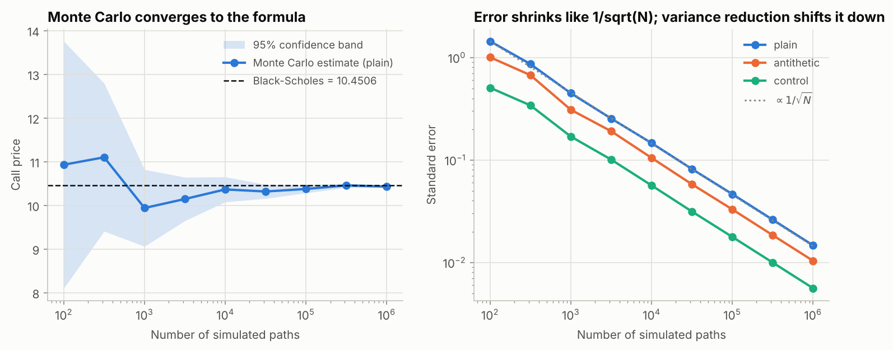
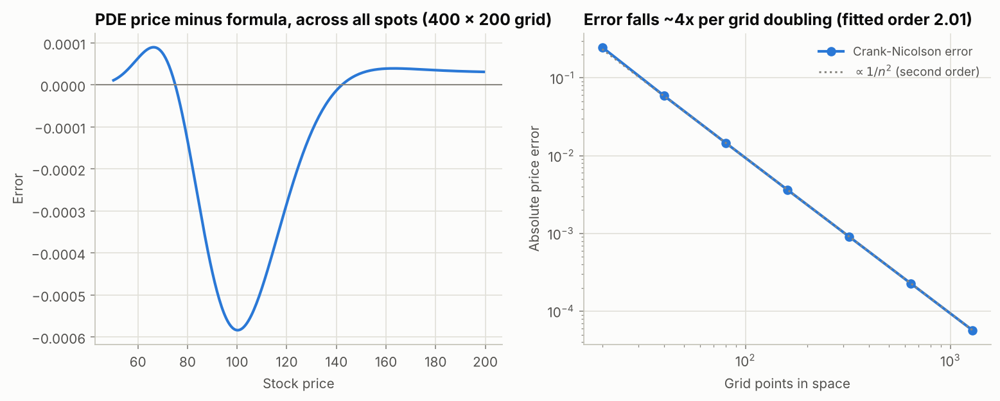
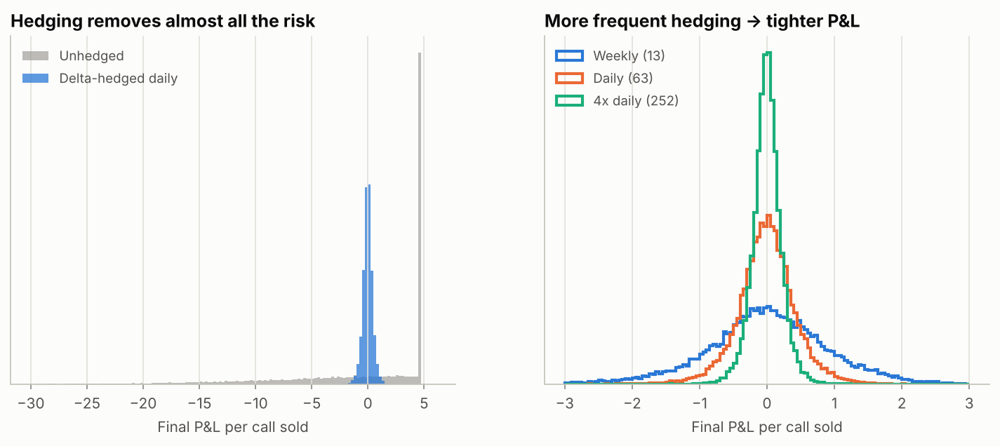
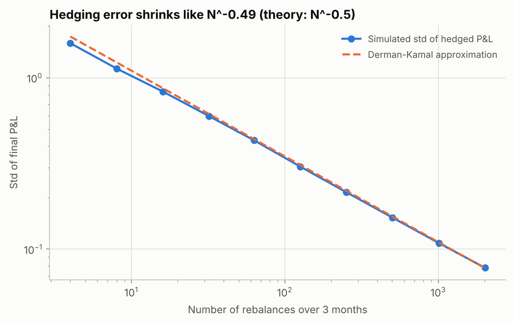
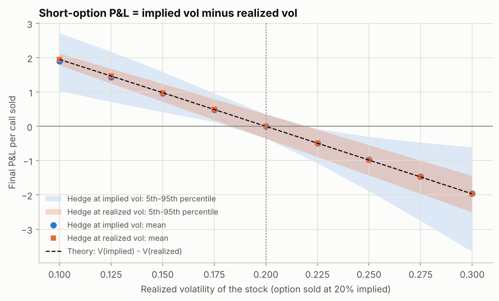
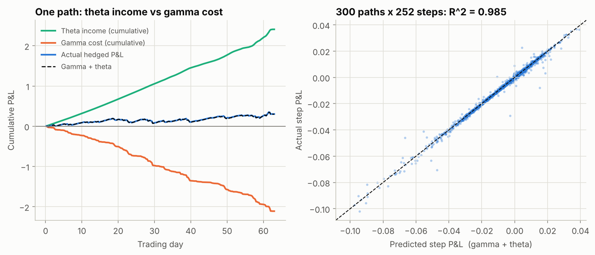
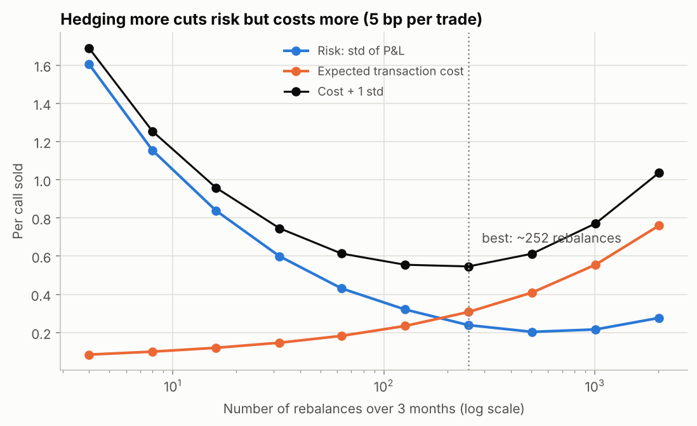
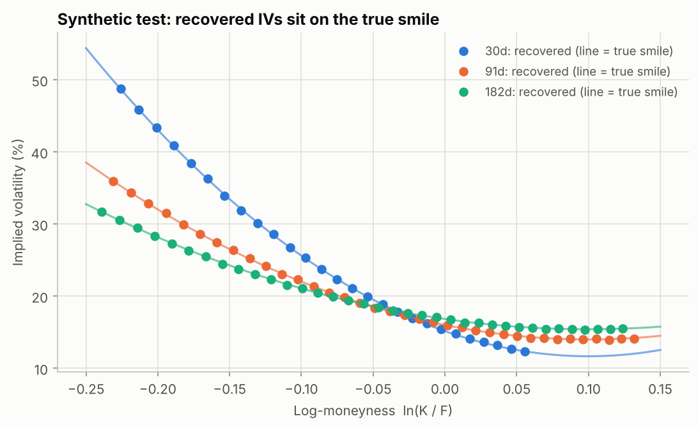
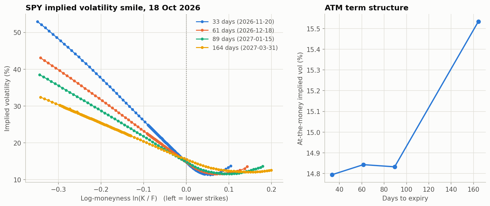
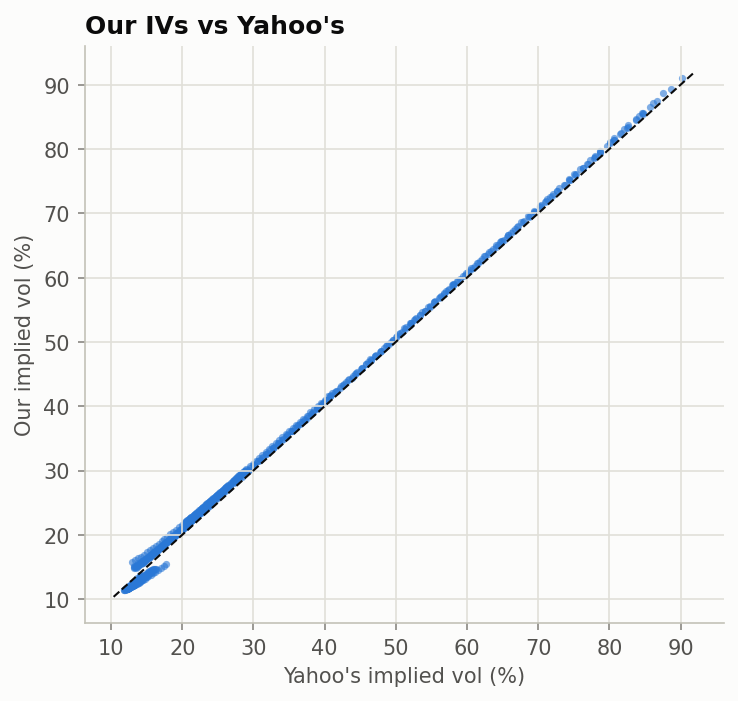

# Options Pricing & Delta-Hedging Lab

A from-scratch Python study of how options are priced, hedged and quoted:

1. **Price** European options four independent ways (Black-Scholes closed form, Monte Carlo with variance reduction, a Crank-Nicolson PDE solver, a binomial tree) and verify they agree; price **American** options with the tree.
2. **Hedge** a short option by Monte Carlo simulation of discrete delta hedging, measuring how the residual risk depends on rebalancing frequency, the stock's drift, the gap between implied and realized volatility, and transaction costs.
3. **Quote**: back out the **implied volatility smile** from live SPY option prices, reading each expiry's forward from near-the-money put-call parity (the CBOE VIX method).

Everything is implemented in plain NumPy/SciPy (no pricing libraries), checked by 73 passing unit tests, and explained step by step in three notebooks.

---

## Key results

**Pricing** (S = K = 100, T = 1 yr, r = 5%, σ = 20%; Black-Scholes call = 10.4506)

| Method | Price | Error vs closed form | Notes |
|---|---|---|---|
| Monte Carlo, 10⁶ paths | 10.4452 ± 0.0147 | within 1 std error | error ∝ N^-0.500, as theory predicts |
| Monte Carlo + control variate, 10⁶ paths | 10.4475 ± 0.0056 | within 1 std error | **6.9× variance reduction** (antithetic: 2.0×) |
| Crank-Nicolson PDE, 400 × 200 grid | 10.4500 | 6 × 10⁻⁴ | measured convergence order **2.01** |
| CRR binomial tree, 1,000 steps | 10.4486 | 2 × 10⁻³ | American put = 6.0900 vs European 5.5735 |

**Delta hedging** (short 3-month ATM call sold at 20% implied vol, 20,000 simulated paths)

| Experiment | Finding |
|---|---|
| Hedge vs no hedge | Daily delta hedging cuts P&L standard deviation **16×** (7.04 → 0.43 per option) |
| Rebalancing frequency | Residual error ∝ N^-0.49; matches the Derman-Kamal formula within about 2% for N ≥ 63 |
| Real-world drift μ from -20% to +30% | Unhedged mean P&L swings from +2.64 to -4.57; **hedged mean stays within ±0.013** (risk-neutral pricing in action) |
| Realized ≠ implied vol | Mean P&L tracks V(σ_implied) - V(σ_realized): e.g. -0.98 when 25% vol is realized (theory -0.98) |
| Gamma/theta attribution | -½Γ(ΔS)² + ½σ²S²Γ Δt explains **98.5%** of the variance of step-by-step hedged P&L |
| Transaction costs (5 bp per trade) | Cost grows and risk shrinks with frequency; expected cost + 1 std is minimized around **126-252 rebalances** (2-4 per day) |

**Implied volatility**: on synthetic quotes generated from a known smile (with bid-ask noise), the pipeline recovers every implied vol within **0.22 vol points** and the forward within 0.02%. On live SPY quotes, the rate implied by the put-call-parity *slope* comes out biased (negative, shrinking like 1/T) because of American early exercise and stale in-the-money quotes, so the pipeline reads only the forward from parity and takes the rate from Treasury bills; a 1-point rate error moves implied vols by under 0.05 vol points. The live SPY smile is produced by notebook 03.

---

## Figures

### Monte Carlo convergence and variance reduction


### Crank-Nicolson is second-order accurate


### Hedging removes almost all the risk; frequency controls what is left



### The real risk is volatility, not direction


### Daily P&L = gamma cost + theta income


### Transaction costs create an optimal hedging frequency


### Implied volatility pipeline validated on a known smile


### Live SPY implied volatility smile and term structure (18 Oct 2026)


Raw data behind this chart: [data/spy_smile_20261018.csv](data/spy_smile_20261018.csv)

### Our implied vols vs Yahoo Finance's



---

## Repository layout

```
options-pricing-hedging-lab/
├── src/optionslab/
│   ├── black_scholes.py   # closed-form prices, Greeks, Black-76, put-call parity
│   ├── monte_carlo.py     # GBM paths; plain / antithetic / control-variate pricing
│   ├── pde.py             # Crank-Nicolson with Rannacher smoothing, log-price grid
│   ├── binomial.py        # Cox-Ross-Rubinstein tree, European and American
│   ├── implied_vol.py     # Brent root-finding with no-arbitrage bound checks
│   ├── hedging.py         # delta-hedging simulator, P&L attribution, Derman-Kamal
│   ├── market_data.py     # Yahoo Finance loader, cleaning, parity forward, smile
│   └── plotting.py        # shared figure style
├── notebooks/
│   ├── 01_pricing_methods.ipynb     # four pricing methods, convergence, Greeks
│   ├── 02_delta_hedging.ipynb       # five hedging experiments
│   └── 03_implied_vol_smile.ipynb   # synthetic validation + live SPY smile
├── tests/                 # 73 pytest checks (textbook values, parity, convergence, hedging theory)
├── figures/               # all figures, regenerated by the notebooks
└── requirements.txt
```

## How to run

**In Google Colab (no installation):** open any notebook from this repository in Colab (File → Open notebook → GitHub). The first cell asks for the GitHub username that hosts the repo, clones it, and everything else runs as-is. Notebook 03 needs internet access to download live option prices, which Colab provides.

**Locally:**
```bash
git clone https://github.com/<your-username>/options-pricing-hedging-lab.git
cd options-pricing-hedging-lab
pip install -r requirements.txt
pytest -q                      # 73 tests, a few seconds
jupyter lab notebooks/
```

## Methods in brief

* **Black-Scholes** under geometric Brownian motion; Greeks in closed form, verified against bump-and-reprice finite differences.
* **Monte Carlo** under the risk-neutral measure with exact one-step GBM sampling; antithetic variates; control variate on the discounted terminal stock price with the optimal regression coefficient.
* **Crank-Nicolson** on x = ln S (constant coefficients), Dirichlet boundaries, 4 implicit Rannacher half-steps to damp the oscillations caused by the payoff kink; one tridiagonal (banded) solve per step.
* **CRR binomial tree** with risk-neutral up-probability p = (e^{rΔt} - d)/(u - d); early-exercise check at every node for American options.
* **Delta hedging** simulated path by path (vectorized over paths): self-financing cash account accruing at r, proportional transaction costs, optional hedge volatility different from pricing volatility.
* **Implied vol**: forward F = K + (C - P)/DF from put-call parity, median over the 6 strikes nearest the money (CBOE VIX method), DF from a reference Treasury rate; the parity-regression rate is kept as a diagnostic; out-of-the-money options only; Black-76 inverted with Brent's method; quotes that violate no-arbitrage bounds return NaN.

## Limitations and next steps

* Constant volatility and lognormal returns: no jumps, fat tails or stochastic volatility. A natural extension is to hedge under a Heston or jump-diffusion world and measure how Black-Scholes deltas fail.
* No bid-ask spread on the option itself, a single rate for borrowing and lending, no market impact.
* SPY options are American-style; using only out-of-the-money quotes keeps the early-exercise bias small but not zero.
* Next: fit an arbitrage-free SVI parameterization to the smile, check calendar/butterfly arbitrage, and calibrate a local-volatility surface.

## References

* F. Black & M. Scholes (1973), *The Pricing of Options and Corporate Liabilities*, Journal of Political Economy.
* J. Cox, S. Ross & M. Rubinstein (1979), *Option Pricing: A Simplified Approach*, Journal of Financial Economics.
* H. Leland (1985), *Option Pricing and Replication with Transactions Costs*, Journal of Finance.
* E. Derman & M. Kamal (1999), *When You Cannot Hedge Continuously: The Corrections to Black-Scholes*, Risk.
* R. Ahmad & P. Wilmott (2005), *Which Free Lunch Would You Like Today, Sir? Delta Hedging, Volatility Arbitrage and Optimal Portfolios*, Wilmott Magazine.
* J. Hull, *Options, Futures, and Other Derivatives*; S. Natenberg, *Option Volatility and Pricing*; J. Gatheral, *The Volatility Surface*.
